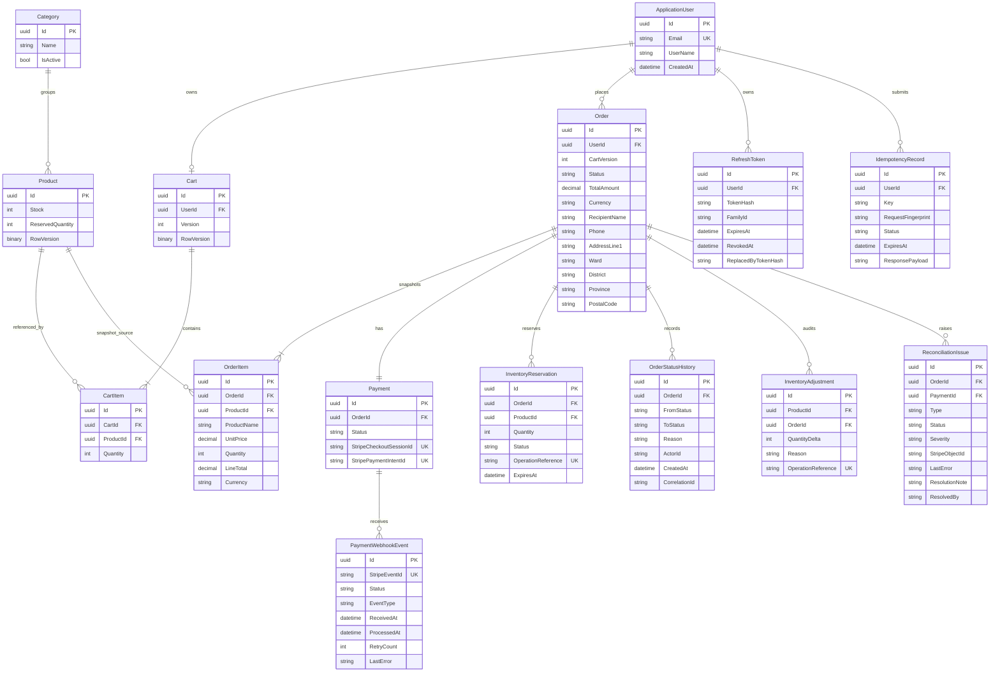

# Phase 00 ERD decisions

The following Mermaid ERD is a design baseline, not a generated EF migration.
Foreign keys, unique indexes, check constraints and precision are specified in
Phase 02a.

`InventoryReservation` is the reservation detail; `InventoryAdjustment` is the
audit ledger. `OrderItem` stores product name, unit price, quantity, line total
and currency snapshots. Shipping fields are immutable order data. All quantity
fields use integer semantics; money fields use decimal semantics.
