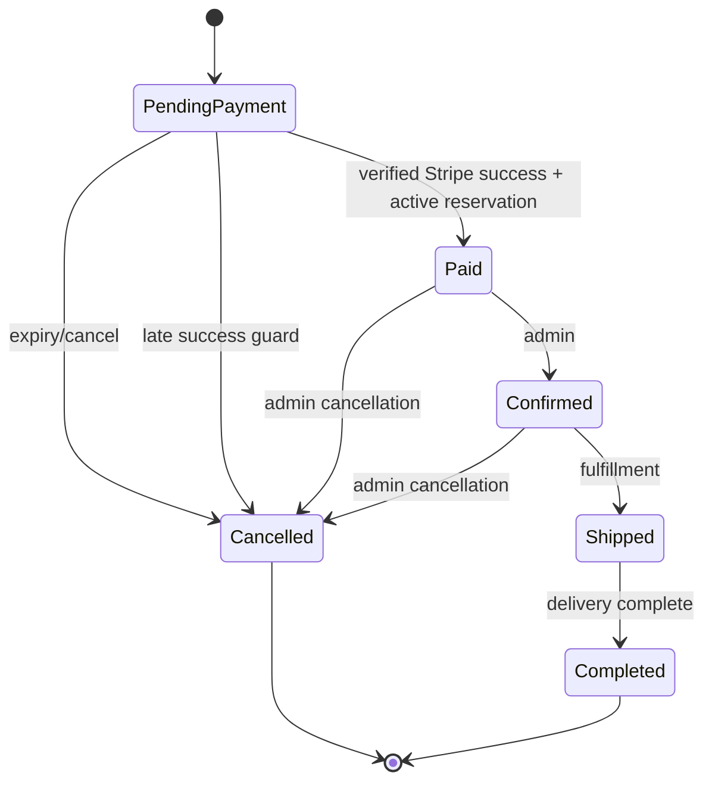
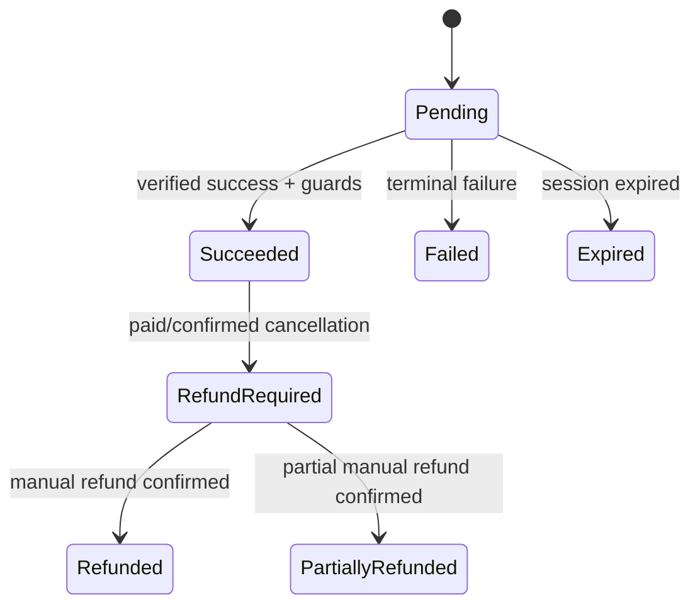
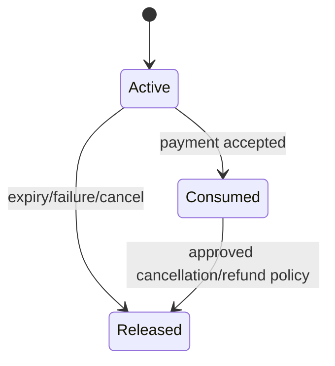

# Phase 00 state machines

The diagrams below are the visual form of the transition tables in
[phase-00-requirements-and-design.md](../../phases/phase-00-requirements-and-design.md).
Any transition not shown is rejected with `409 Conflict`.

## Order status

Late success does not use the `PendingPayment -> Paid` transition. It leaves
the order cancelled and opens a reconciliation issue.

## Payment status

Late payment is intentionally represented as `Succeeded` plus an open
`ReconciliationIssue`; it does not reopen the order.

## Inventory reservation status

Every side effect is protected by an order/operation reference and may be
applied at most once.
